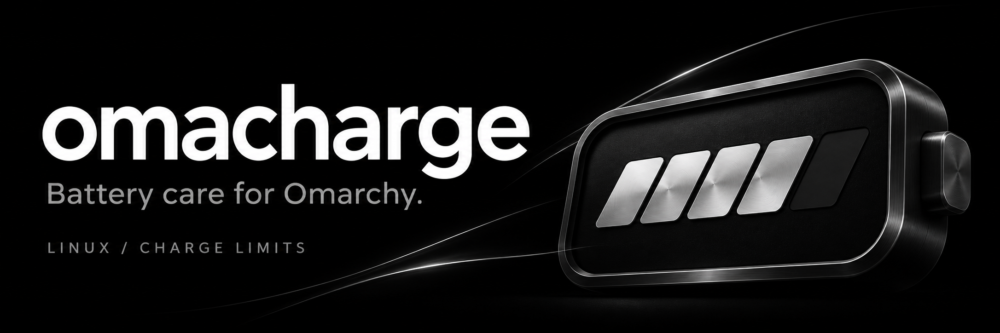
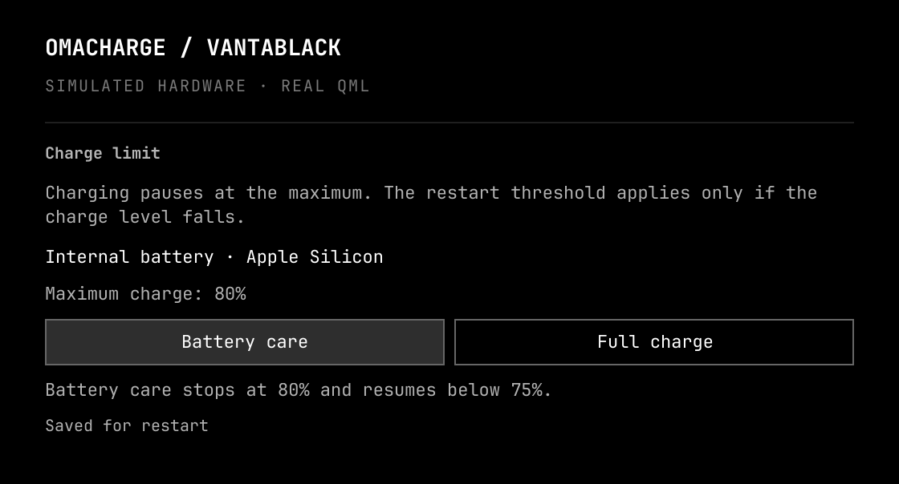
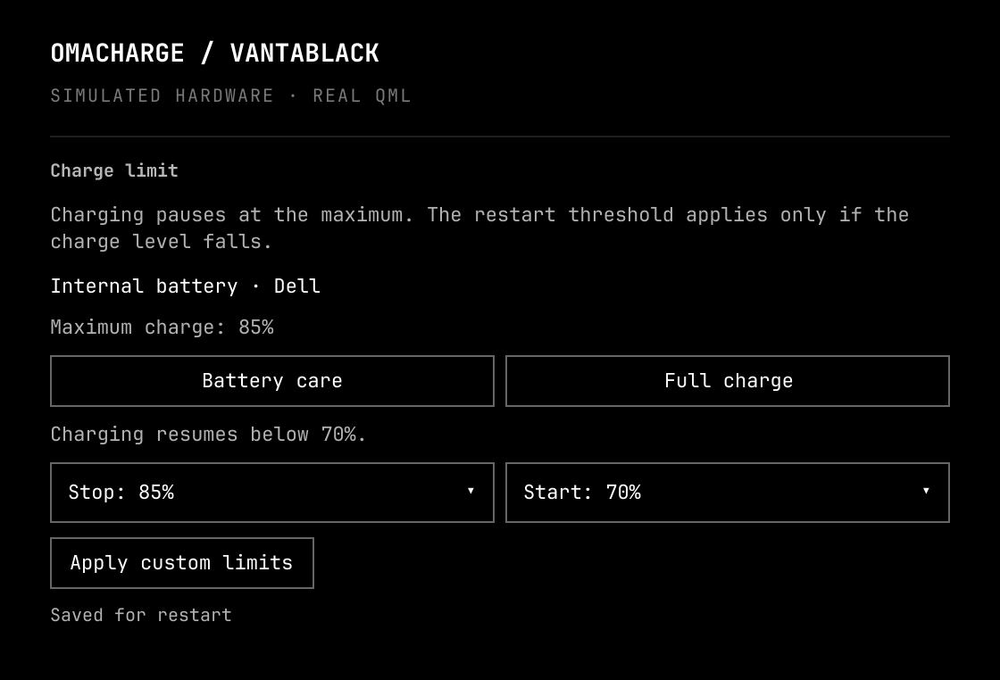
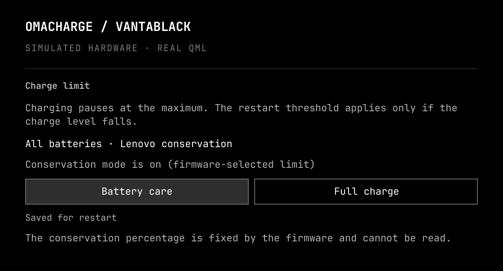
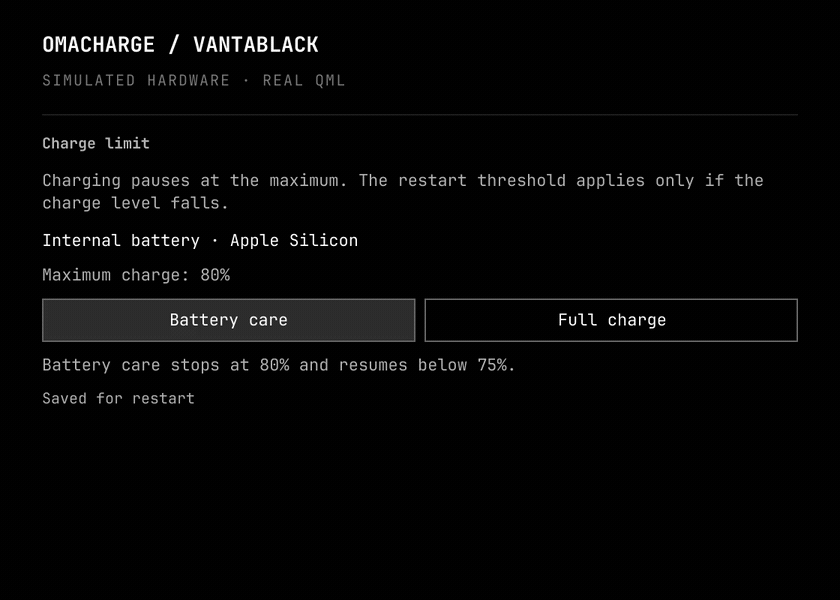

# Omacharge

[](https://github.com/kartikkabadi/omacharge/actions/workflows/tests.yml)
[](LICENSE)
[](https://omarchy.org)

Battery charge limits inside **Omarchy's existing battery panel**. Omacharge
detects the available hardware controls, offers the supported settings, and keeps
verified choices ready to restore.

- **Controls that fit the laptop.** Fixed limits on Apple Silicon, conservation
  modes on supported Lenovo and Samsung machines, and custom percentages where
  the driver supports them. Independent batteries keep independent settings.
- **Plug in and leave it.** Charging pauses at the chosen maximum. The restart
  threshold applies only if charge falls; it does not schedule discharge cycles.
- **Settings that stay saved.** An authenticated helper saves verified values.
  Event-driven hooks restore them at boot, after sleep and when batteries appear.
- **The panel you already use.** Battery status, power profiles, percentage
  toggling and the usual shortcuts stay together. Colours follow your theme.
- **Local operation.** No accounts, analytics, network requests or TLP dependency.
  Detection works before administrator setup; unsupported hardware stays read-only.

Omacharge builds on [Omarchy's power panel](https://github.com/omacom/omarchy).
The original work and copyright are retained under the [MIT license](LICENSE).
Maintained by [Kartik (@kartikkabadi)](https://github.com/kartikkabadi).

## Install

```bash
omarchy plugin add https://github.com/kartikkabadi/omacharge.git --enable
```

Open the battery panel and choose **Finish setup** to enable charge changes and
saved-state restoration. Desktop authentication is handled for you.

For a complete installation from a checkout, run **as your normal desktop user**:

```bash
git clone https://github.com/kartikkabadi/omacharge.git
cd omacharge
./install.sh
```

The installer handles authentication; do not prefix it with `sudo`. It backs up
the bar configuration and replaces the existing power widget in place. Installing
does not choose a new limit. A verified existing Apple/Asahi limit is adopted.
See [installation and updates](docs/INSTALL.md), including migration from a local
power-panel clone.

## Remove

Choose **Full charge** first if you want to lift the current limit. Then run:

```bash
cd ~/.config/omarchy/plugins/io.github.kartikkabadi.omacharge
./uninstall.sh --backend
omarchy plugin remove io.github.kartikkabadi.omacharge --yes
```

Removal restores the stock power widget and removes the helper and restore
hooks. Saved policies remain on disk; the current firmware setting is preserved.
See [removal details](docs/INSTALL.md#removal).

## Three kinds of charge control

| Battery care | Custom thresholds | Conservation mode |
| :---: | :---: | :---: |
| [](assets/screenshots/battery-care.png) | [](assets/screenshots/custom-limits.png) | [](assets/screenshots/conservation.png) |
| Hold near the supported maximum. | Choose valid start and stop values. | Use the firmware's fixed care mode. |

These Vantablack previews render the real QML component with simulated hardware
and example values. They show the interface, not additional hardware-test claims.
The Apple Silicon backend is physically verified on the M1 Pro described below.

[](assets/omacharge-demo.mp4)

[Watch the MP4 preview](assets/omacharge-demo.mp4). The preview uses the same
rendered states shown above; it does not change a real battery's settings.

## Holding at 80% means holding, not cycling

Once the battery reaches its maximum, charging pauses while the laptop normally
runs from external power. A 75% restart threshold means charging resumes **if**
the level falls below 75%. It does not deliberately drain an 80% battery to 75%,
or cycle it down to 20%. [How charge thresholds work](https://linrunner.de/tlp/faq/battery.html#what-is-battery-care).

On supported Apple Silicon firmware, Battery care selects 80% with a 75% restart.
Full charge restores the native 100% setting. Other hardware can expose different
values or a fixed mode; the panel follows the detected interface.

## Compatibility and limits

Requires Python 3.11+ at `/usr/bin/python3`, Omarchy's Quickshell shell, systemd,
sudo and polkit. Tested on a **14-inch 2021 M1 Pro MacBook Pro**, Arch Linux ARM
kernel 7.2.11-14-1-ARCH, Omarchy 4.5.0, Quickshell 0.3.2 and Qt 6.12.

Adapters cover Apple Silicon, ThinkPad including legacy SMAPI, ASUS, Dell,
Huawei, Lenovo conservation modes, LG, MSI, Samsung, Sony, System76,
Toshiba/Dynabook, Tuxedo/Clevo, ChromeOS EC and Wilco. Framework can use its
official tool when the native interface is absent. Each requires its supported
kernel/firmware interface; a brand name alone does not establish compatibility.

**Other physical laptops remain unverified.** Their adapters have simulated-kernel
coverage and need community testers. A real reboot and suspend/resume were not
performed on the test Mac; the enabled restore service was exercised directly.
The [compatibility matrix](docs/COMPATIBILITY.md) lists exact interfaces and limits.

Driver read-back confirms the driver's reported setting, not an independent
measurement. Firmware can ignore or misreport a value. Active TLP makes charge
controls read-only so two managers do not compete. Omacharge controls internal
laptop batteries, not phones, mice or earbuds.

## Guides

- [Installation, updates and removal](docs/INSTALL.md)
- [Controls, saved settings and keyboard shortcuts](docs/CONTROL.md)
- [Hardware compatibility](docs/COMPATIBILITY.md)
- [Troubleshooting](docs/TROUBLESHOOTING.md)
- [Development and verification](docs/DEVELOPMENT.md)
- [Validation history and hardware-test limits](docs/VALIDATION.md)

Report reproducible problems through [GitHub issues](https://github.com/kartikkabadi/omacharge/issues),
including your model, kernel, Omarchy version, detected driver and visible error.
Review diagnostics before posting; omit private environment dumps and serial numbers.

## Credits and license

MIT. The power panel and model derive from Omarchy, copyright David Heinemeier
Hansson. Hardware behavior was checked against Linux's power-supply ABI, TLP's
vendor documentation and Framework's official tool. No TLP or Framework source
is bundled. See [source references](docs/SOURCES.md) and [media provenance](docs/MEDIA.md).
