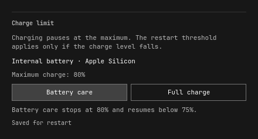

# Battery Care for Omarchy



Battery charge controls inside Omarchy's existing battery panel. The plugin discovers the available kernel interface, offers the values that interface supports, verifies the driver's response, and restores saved settings at boot, after sleep, and when a battery appears.

**Version 0.1.0: tested on a 2021 M1 Pro MacBook Pro. Other hardware adapters have simulated-kernel coverage and need physical-device testers.** A brand name alone never guarantees support: the required driver and firmware interface must be present.

## Features

- Replaces the standard power widget in place; keeps battery status, power profiles, right-click percentage toggling, and the normal power-panel shortcuts.
- Detects independent batteries and shared, whole-laptop controls.
- Shows Battery care / Full charge presets, with custom start/stop values where the driver supports them.
- Handles Apple's fixed limits and Lenovo/Samsung conservation modes without inventing percentages.
- Uses desktop administrator authentication, a root-owned backend, and an event-driven restore service. No continuously running root daemon, network requests, telemetry, TLP dependency, or power-profile changes.
- Leaves unknown hardware read-only. An active TLP service also makes charge controls read-only so two managers do not compete.
- Follows Omarchy's theme and translation system; currently ships an English catalog with fallback for other languages.

## Install

Requires an Omarchy shell with the version-1 plugin API, Python 3.11+, systemd, sudo, and polkit. Developed and tested against Omarchy 4.5.0. Other Omarchy releases are not yet qualified.

From this checkout:

```bash
./install.sh
```

The script installs the protected backend with administrator authentication, backs up the current bar configuration, copies the plugin into `~/.config/omarchy/plugins/community.battery-care`, and replaces the existing power widget. The shell restarts once so updates cannot keep cached QML code. Installing does **not** select a new limit. An existing verified Apple/Asahi setting is adopted.

Click the battery icon, then choose a preset or apply custom limits. Settings apply only to the selected battery unless the panel says **All batteries**. Your other batteries keep their own settings.

For a frontend-only installation, run `./install.sh --skip-backend`. The panel can then show detected controls; **Finish setup** installs the backend when you are ready.

Once hosted in a Git repository, the frontend is compatible with `omarchy plugin add <repository-url> --enable`; use **Finish setup** once for the protected backend. No public repository has been created by this checkout.

## What holding a charge limit means

When plugged in, reaching the maximum pauses battery charging while the laptop normally uses external power. A lower restart threshold is a condition for charging to resume if the level falls; it is not a target for deliberate discharge. Battery Care does not schedule discharge/recharge cycles. For example, the Apple 75/80 setting normally holds near 80% rather than actively cycling between those values. See [TLP's explanation of charge thresholds](https://linrunner.de/tlp/faq/battery.html#what-is-battery-care).

## Hardware

See [the compatibility matrix](docs/COMPATIBILITY.md) for the exact interfaces, ranges, dependencies, and current test evidence. Implemented adapters cover Apple Silicon, ThinkPad including legacy SMAPI, ASUS, Dell, Huawei, Lenovo conservation modes, LG, MSI, Samsung, Sony, System76, Toshiba/Dynabook, Tuxedo/Clevo, ChromeOS EC, Wilco, and Framework's official tool fallback.

The plugin cannot add missing firmware or driver support. It does not control charging of phones, earbuds, mice, or other attached accessories.

## Keyboard

| Key while the battery panel is open | Action |
|---|---|
| `8` | Battery care for the selected battery (its hardware-specific preset) |
| `0` | Full charge for the selected battery |
| Arrow keys / `h j k l` | Move the panel cursor between charge presets and power profiles |
| Enter / Space | Activate the highlighted preset or profile |
| Esc | Close the panel |

Use the pointer to select a battery on multi-battery laptops and to open custom-value pickers. Picker arrow keys operate their choices while open.

## Persistence and permissions

The backend lives at `/usr/local/libexec/omarchy-battery-care`. Saved selections are in `/etc/omarchy-battery-care.json`, keyed to the reported machine model and detected driver. Root rediscovers devices and validates IDs and numeric values on every change; a request cannot supply a filesystem path. Saving uses atomic replacement and symlink checks. Operations are serialized with a root-owned lock.

A systemd oneshot service, udev add rule, and system-sleep post hook restore saved selections. Restore ignores selections for a different reported machine model or driver and does not guess paths for missing devices. On Apple Silicon, the existing `/etc/udev/macsmc-battery.conf` setting is kept in sync.

Desktop changes try `sudo -n` first and use polkit authentication only if sudo explicitly requires authentication. A failed hardware operation is never automatically repeated through a different privilege route. No passwordless sudo or polkit rule is added. The polkit action uses `auth_admin_keep`, so the desktop may remember authentication briefly.

Some hardware retains limits when powered off; others reset them. The service can restore limits only once Linux and its driver are running. Read-back confirms the driver's reported setting, which is not independent electrical measurement. Some ASUS firmware can ignore settings even when the driver reports them.

## Uninstall

```bash
./uninstall.sh             # Restore the stock power widget
./uninstall.sh --backend   # Also remove the protected helper and restore hooks
```

Uninstall preserves the current hardware setting and saved configuration. Select Full charge first if you want to remove the limit. Existing Apple/firmware persistence may continue after uninstall. `omarchy plugin remove community.battery-care --yes` removes the plugin's frontend files after disabling it.

## Development and tests

```bash
python3 -m unittest discover -s tests -v
python3 tests/run-ui.py
```

Unit tests use isolated temporary sysfs trees and a simulated kernel enforcing threshold ordering. They do not change real hardware or request root access. The UI harness uses the real QML component and a fake unprivileged backend to exercise presets, state updates, hardware-specific pickers, restart bounds, stable refresh, and hostile-looking text. UI tests require an installed Omarchy shell and Quickshell; the Python tests run in ordinary CI.

For support, run `python3 client.py status` and review its output before sharing. It includes manufacturer/model and battery IDs, but deliberately excludes serial numbers, user paths, and credentials. Report the exact model, kernel, Omarchy version, driver, requested values, and observed result. Physical-device verification is tracked in [VALIDATION.md](docs/VALIDATION.md).

## Credits and license

MIT. The battery panel and `Model.js` derive from Omarchy, copyright David Heinemeier Hansson; the original notice is preserved in [LICENSE](LICENSE). Battery Care additions are copyright 2026 Kartik Kabadi and contributors. Hardware behavior was checked against [Linux's power-supply ABI](https://github.com/torvalds/linux/blob/master/Documentation/ABI/testing/sysfs-class-power), [TLP's vendor documentation](https://linrunner.de/tlp/settings/bc-vendors.html), its reference adapters, and Framework's official tool. TLP code is not bundled or required. See [SOURCES.md](docs/SOURCES.md).
